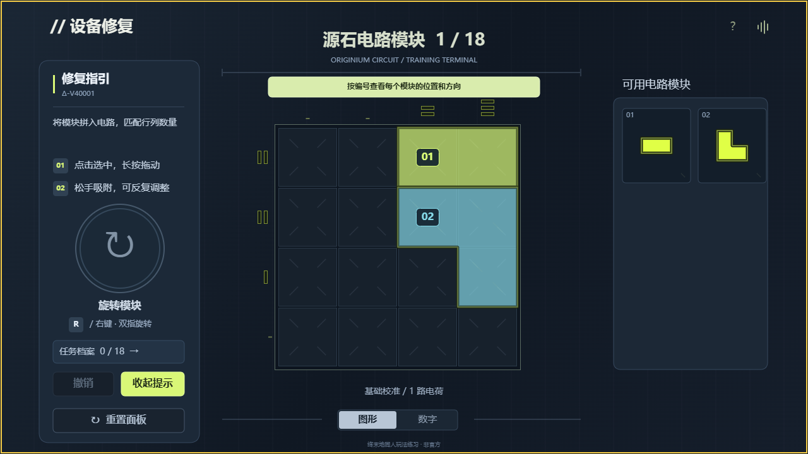

# 源石电路修复

一个受《明日方舟：终末地》源石电路玩法启发的非官方同人拼图游戏。使用原生 JavaScript + Canvas 实现，同一套玩法和渲染代码支持 **H5 网页**与**抖音小游戏**。

**[在线试玩](https://mjklfxy.github.io/endfield-game/)** · [MIT 许可证](LICENSE)



## 玩法

拖动、旋转几何模块，让每种颜色的行列数量与目标一致。实心方条表示当前数量，空心方条表示待补齐数量，斜纹方条和红色光带表示超额。用完所有模块即可完成修复，部分格子可以留空。

- 点击模块只选中，选中高亮平滑显隐；长按约 300ms 或直接移动即可拖拽。
- 拖动时保持跟手，松手后才吸附。其他已放置模块渐暗，结束后恢复亮度。
- 鼠标拖动时按 **R / 右键**旋转；触屏拖动时用另一根手指点击旋转按钮。
- 重叠或部分越界允许保留并以红色呼吸提示，可继续调整；拖回右侧模块区可以取回。
- 图形 / 数字显示可切换，支持撤销、重置、进度保存与原创合成音效。
- 提示分两级：先展示完整答案轮廓，再展示分色、带编号的模块拼法；不会自动安装。
- 修复完成后有白色方框扩散、黄色发光提示条、短暂文字快闪与继续 / 重玩动画。

目前有 18 关：单色 4×4、双色 5×5、三色 6×6 各六关。关卡先生成有效摆法，再统计行列目标，使用固定种子保证每次打开一致。保证有解，接受等价有效答案；尚未按唯一解或严格难度指标筛题。

## 本地运行 H5

需要 Node.js 22 或更新版本，无第三方运行依赖。

```sh
git clone https://github.com/mjklfxy/endfield-game.git
cd endfield-game
npm ci
npm start
```

打开 <http://127.0.0.1:4174/endfield-game/>。修改代码后重新运行 `npm start`，刷新网页查看结果。端口冲突时可设置 `CIRCUIT_PREVIEW_PORT`。

```sh
npm test       # 玩法、输入、关卡求解、原生适配与动画交互回归
npm run build  # 生成可静态部署的 dist/
```

`dist/` 可以部署到普通静态服务器，使用相对资源路径，兼容 GitHub Pages 的仓库子路径。无需服务器、账号或数据库。

## 导入抖音开发者工具

**只导入仓库中的 `game/` 文件夹**，项目类型选择「小游戏」，不要导入整个仓库。当前配置使用 `testAppId`，横屏运行。正式上传需要自己的 AppID 与平台审核。

Node.js 测试、网页适配器和开发脚本都位于 `game/` 外，避免抖音编译器扫描到 `node:` 等宿主不支持的依赖。H5 与抖音共用源码，进度分别保存在各自的本地存储中。

浏览器测试、原生模拟测试与抖音真机体验属于不同验证范围；自动测试通过不替代真机验收。项目尚未接入广告、支付或收入结算。

## 目录

```text
game/                       抖音原生导入目录
  src/puzzle.js             形状、旋转、碰撞、行列计数、生成与求解
  src/game-app.js           玩法状态、Canvas UI、输入与动画
  src/platform-douyin.js    tt 触摸、存储、生命周期与音效
  assets/                   原创合成音效
web/                        H5 入口和浏览器适配器
tools/                      静态站构建、本地预览
tests/                      Node.js 回归测试
.github/workflows/pages.yml 自动测试与 GitHub Pages 发布
```

## GitHub Pages

`main` 分支每次推送会自动运行测试、构建网站并部署到：

<https://mjklfxy.github.io/endfield-game/>

Fork 后，在仓库 **Settings → Pages → Source** 选择 **GitHub Actions**，然后运行 **Test and deploy GitHub Pages** 工作流即可。PR 会运行测试和构建，不会部署。

## 开源与声明

原创代码与合成音效采用 [MIT License](LICENSE)，欢迎修改、反馈问题和提交 PR。

本项目与《明日方舟》《明日方舟：终末地》及其权利方无关联，未使用官方角色图片、Logo、音乐或游戏资源。相关名称与商标的权利归原权利方所有，不包含在本项目的 MIT 授权中。
